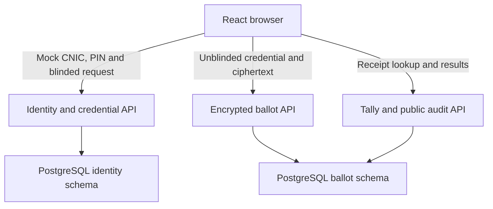

# VoteSecure PK

VoteSecure PK is a local academic prototype of the Pakistan Digital Electoral Voting and Verification Platform. It uses React, a Node.js/Express API, and PostgreSQL. The election, voter accounts and verification service are entirely synthetic.

## Run locally

Install Node.js 22.13 or later and either Docker Desktop with Compose or PostgreSQL 16. From this folder, run the following in PowerShell.

```powershell
Copy-Item .env.example .env
npm.cmd install
docker compose up -d --wait
```

Set `ADMIN_KEY` in `.env` to a private local value of at least 20 characters before starting. Compose listens on loopback port 5435. For an existing PostgreSQL installation, create a dedicated empty demo database and set `DATABASE_URL` instead of running Compose. The app creates its schemas and seeds six synthetic voters on the first start.

Run `npm.cmd run dev` and open [http://localhost:5173](http://localhost:5173). For a built version, stop the dev processes, run `npm.cmd run build` and then `npm.cmd start`. Open [http://localhost:3000](http://localhost:3000).

## Demo walkthrough

1. Open **Cast ballot**. Try **Under 18**, **Different constituency**, and **Missing roll entry** to see three eligibility failures.
2. Choose **Eligible voter A**, click **Verify and continue**, select a candidate, and cast the ballot. Download the receipt. Keep the original tab open until submission succeeds because it holds the anonymous credential.
3. Use a separate private browsing session or browser profile to try the same account again. The API rejects a second issuance. Choose **Eligible voter B** there to cast a second ballot.
4. Open **Election admin** in the original session. Enter the admin key from `.env`, confirm, and close the polls.
5. Open **Results & audit**. Verify the saved receipt against the published Merkle root and download the audit data. Try altering a digit in the receipt to trigger a verification failure.

Poll closure is permanent for the demo database. To run the walkthrough again, point `DATABASE_URL` at another empty demo database and open a fresh private browsing session.

## Architecture



| Component | Behavior |
| --- | --- |
| Mock verification | Validates the demo PIN, citizenship, CNIC issuance, age at the fixed cutoff, roll registration, residence, legal eligibility and constituency. |
| Credential issuer | Issues an RFC 9474 blind RSA signature. The browser creates a random serial. The issuer sees a blinded request and stores one issuance per voter per election. |
| Ballot intake | Receives the credential and RSA-OAEP ciphertext. PostgreSQL enforces a single use of the serial across concurrent requests. An identical retry returns the original receipt. |
| Poll close | Serializes with active intake using PostgreSQL row locks. Decrypts the ballots, counts known options and records malformed ballots as invalid. Closing and publication commit together. |
| Audit | Signs the published tally and Merkle root with ECDSA. The browser verifies a Merkle inclusion proof. The export includes the ordered receipt hashes so an observer can recalculate the root. |

### Independent audit of the export

Keep the public audit key from the configured demo server before closing polls. In PowerShell, while the API is running:

```powershell
(Invoke-RestMethod http://127.0.0.1:3000/api/election).auditKey |
  ConvertTo-Json -Depth 6 | Set-Content -Encoding ascii audit-public.jwk.json
```

Run `npm.cmd run audit -- votesecure-audit.json audit-public.jwk.json` using that key and the downloaded audit JSON. A receipt proves inclusion of an encrypted submission. The publication signature authenticates the operator's tally. Neither check independently proves that the tally matches the decrypted ballot contents.

## Checks

- `npm.cmd test` runs the dependency-free eligibility, encrypted tally, signature, and Merkle checks.
- `npm.cmd run test:integration` targets a running server connected to a **fresh demo database**. It casts one ballot and closes the election. It covers ineligible voters, concurrent duplicate issuance and casting, retry behavior, wrong constituency, an altered credential, and the published proof.

## Prototype boundaries

- Identity and ballot routes use separate tables and data contracts in one API process. The ballot table has no voter identifiers. The demo operator controls all keys and can inspect ciphertext and process traffic. Timing/network correlation, coercion, and compromised devices remain out of scope.
- The prototype is a single-seat, final-ballot workflow. The proposal's homomorphic encryption, threshold trustees, paper override, re-voting, liveness and fraud detection remain future work.
- The API uses a PostgreSQL pool and has no in-memory voter sessions. Multiple local processes would need the same database, configuration, and election keys. Batch tallying and audit publication run in memory. The proposal's national-scale and throughput targets have not been measured.
- Use only the synthetic accounts. This is a localhost classroom demo. The seeded PINs are deliberately public, and election keys are saved to `.demo-data/` by default.

## References

- [Election Commission of Pakistan voter instructions](https://www.ecp.gov.pk/storage/files/2/ERp/Instructions%20for%20Voters%20Updated.pdf)
- [Elections Act, 2017, sections 26 and 27](https://www.ecp.gov.pk/storage/files/2/Elections%20Act%202017%20updated/Updated%20Elections%20Act%202017-231011-105435.pdf)
- [RFC 9474, RSA Blind Signatures](https://www.rfc-editor.org/rfc/rfc9474.html)
- [Cloudflare blind RSA implementation](https://github.com/cloudflare/blindrsa-ts)

